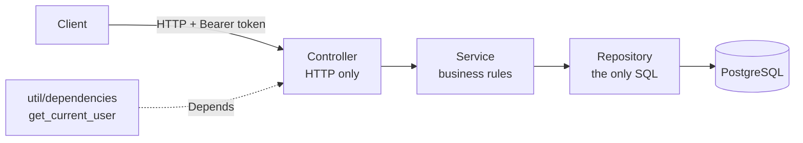

# Notes Service

A multi-user notes microservice. Users register and log in, then create, list,
edit and delete their own notes. Nobody can read, edit or even detect anyone
else's.

**Python 3.12+ · FastAPI · PostgreSQL 17 · psycopg 3 (raw SQL) · PyJWT · pytest · Docker**

[](https://github.com/JamesKevinJones/notes-service/actions/workflows/ci.yml)
[](LICENSE)

---

## The problem this exists to solve

Once more than one person uses a CRUD API, every request has two questions to
answer: *who is asking?*, and *is this row theirs?* Getting the first one wrong
is a login bug. Getting the second wrong is a data leak, and it's the most
common kind (broken access control sits at #1 on the OWASP Top 10).

### The leak

The usual mistake is to load by id and check ownership afterwards, or to forget
the check entirely on one route out of five:

```python
note = repo.find_by_id(note_id)          # loads anyone's note
if note.user_id != current_user.id:      # remembered here...
    raise Forbidden()                    # ...and the 403 confirms note 42 exists
```

Every new route is another chance to forget the `if`. And a 403 tells an
attacker which ids are real, so they can walk the id space.

### The fix

Ownership isn't a check in this codebase. It's part of every query. The
repository has no method that loads a note without an owner:

```sql
SELECT * FROM notes WHERE id = %s AND user_id = %s
UPDATE notes SET ... WHERE id = %s AND user_id = %s RETURNING *
DELETE FROM notes   WHERE id = %s AND user_id = %s RETURNING id
```

Someone else's note matches zero rows, exactly like a note that doesn't exist,
so both return the same **404**. There's no `if` to forget and no 403 to leak
which ids exist. `test_users_cannot_touch_each_others_notes` checks this for
get, list, update and delete. Removing the `user_id` filter from one query makes
it fail, which shows the test actually catches the bug.

---

## Other decisions worth reading

| Decision | Why |
|---|---|
| **JWT access tokens** (HS256, 60 min) | Checking a token needs only the signing key, not a session table, so any number of API instances can check it. The cost is that a token can't be revoked before it expires. That's acceptable for 60 minutes, and refresh tokens are on the roadmap. |
| **The current user is still loaded from the DB** | A valid signature only proves the token was issued. Loading the row means a deleted user's token stops working immediately. |
| **`hashlib.scrypt` for passwords** | Memory-hard, in the standard library, with OWASP's recommended cost settings (n=2^14, r=8, p=1) and a 16-byte random salt per password. No extra dependency. Comparison is constant-time (`hmac.compare_digest`). |
| **`INSERT ... ON CONFLICT (email) DO NOTHING`** for signup | SELECT-then-INSERT lets two simultaneous signups with the same email both pass the check. The unique constraint decides in a single statement, so there's no race. |
| **One 401 for "no such email" and "wrong password"** | Login can't be used to find out which emails are registered. |
| **Refuses to start with a short `JWT_SECRET`** | Deploying with the example placeholder would let anyone forge a token for any user. Failing at import time is cheaper than finding out later. |
| **Raw SQL, no ORM** | Every query is visible and reviewable, which is what makes the ownership rule auditable at a glance. |

Full reasoning, with dates, is in [`docs/DECISIONS.md`](docs/DECISIONS.md).

---

## Architecture

Strict layers. Each one calls only the layer directly below it:



- **Controllers** parse requests into Pydantic DTOs, call one service method and return a response DTO. No `try/except`.
- **Services** hold the rules: emails are lowercased, a missing row becomes `NoteNotFoundError`, a bad token becomes `AuthenticationError`. They don't import FastAPI or SQL.
- **Repositories** are the only place SQL lives. Every value is parameterized (`%s`), and they return dataclass entities or `None`.
- **Entities vs DTOs**: `User` has `password_hash`, `UserResponse` doesn't. The database schema and the API contract change independently, and a hash can't reach the wire by accident.
- **Errors** are mapped in one place (`application.py`): not found → 404, email taken → 409, auth failure → 401 with `WWW-Authenticate: Bearer`.
- **Transactions**: FastAPI's `Depends` opens one connection per request, so each request is one transaction, rolled back if anything raises.

### What happens on `GET /notes/42`

1. `HTTPBearer` reads `Authorization: Bearer <jwt>`. A missing header → 401.
2. `AuthService.user_from_token` checks the signature and expiry, then loads the user row. Any failure → 401.
3. `NoteService.get(user.id, 42)` calls `NoteRepository.find_by_id(user.id, 42)`.
4. `WHERE id = 42 AND user_id = <you>`: no row means `NoteNotFoundError` → 404. A row → `NoteResponse` → 200.

---

## API

| Method | Path | Auth | Success | Errors |
|---|---|---|---|---|
| `POST` | `/auth/register` | none | 201 user | 409 email taken, 422 invalid |
| `POST` | `/auth/login` | none | 200 `{access_token, token_type}` | 401 |
| `GET` | `/users/me` | Bearer | 200 user | 401 |
| `POST` | `/notes` | Bearer | 201 note | 401, 422 |
| `GET` | `/notes` | Bearer | 200 your notes, newest first | 401 |
| `GET` | `/notes/{id}` | Bearer | 200 note | 401, 404 |
| `PATCH` | `/notes/{id}` | Bearer | 200 note (send only the fields to change) | 401, 404, 422 |
| `DELETE` | `/notes/{id}` | Bearer | 204 | 401, 404 |
| `GET` | `/health` | none | 200 `{status, db}` | 500 if the DB is down |

Interactive docs at `http://localhost:8000/docs`. Register, log in, then paste
the `access_token` into **Authorize**.

```bash
curl -X POST localhost:8000/auth/register -H "Content-Type: application/json" \
     -d '{"email": "ada@example.com", "password": "correct-horse-battery"}'

TOKEN=$(curl -s -X POST localhost:8000/auth/login -H "Content-Type: application/json" \
     -d '{"email": "ada@example.com", "password": "correct-horse-battery"}' | jq -r .access_token)

curl -X POST localhost:8000/notes -H "Authorization: Bearer $TOKEN" \
     -H "Content-Type: application/json" -d '{"title": "first", "content": "hello"}'
```

---

## Running it

**Prerequisites:** Python 3.12+, Docker.

```bash
# 1. Postgres (schema.sql runs automatically on a fresh volume)
docker compose up -d

# 2. Config: copy the example, then set a real secret
cp .env.example .env
python -c "import secrets; print(secrets.token_hex(32))"   # paste into JWT_SECRET

# 3. Dependencies
python -m venv .venv
.venv/bin/pip install -r requirements.txt        # Windows: .venv\Scripts\pip

# 4. API
.venv/bin/uvicorn app.application:app --reload

# 5. Tests
.venv/bin/pytest -v
```

Upgrading a database created before users existed? Run
[`migrations/001_users.sql`](migrations/001_users.sql) once. It deletes existing
notes, because they have no owner.

---

## Tests

13 integration tests, nothing mocked. `TestClient` sends real HTTP requests into
the app, and the app talks to the real Postgres. The `signup` fixture creates a
user with a random email and returns a ready-made auth header, so tests don't
interfere with each other and can be rerun against the same database.

| Area | What's checked |
|---|---|
| Ownership | User B gets 404 on A's note for get, update and delete, and an empty list |
| Tokens | Missing, garbage, expired and wrongly-signed tokens all get 401 |
| Signup | 201 without the hash in the body, case-insensitive duplicate → 409, bad email / short password → 422 |
| Login | Wrong password and unknown email return the same 401 body |
| Hashing | Round-trips, rejects a wrong password, salted (same password, different hashes) |
| CRUD | Full create → read → list → patch → delete → 404 cycle, 404 on missing ids, empty title → 422 |

[CI](.github/workflows/ci.yml) runs the same 13 tests on every push and pull request,
against a throwaway Postgres 17 service container loaded from `schema.sql`.

---

## Project layout

```
app/
  application.py        app, routers, exception → status mapping
  controller/           auth_controller, note_controller, health_controller
  service/              AuthService, NoteService
  repository/           UserRepository, NoteRepository (all SQL)
  entity/               User, Note dataclasses (DB shape)
  dto/                  Pydantic request/response models (wire shape)
  util/                 database, dependencies (get_current_user), security, exceptions
migrations/             hand-run SQL for existing databases
tests/                  conftest (signup fixture), test_auth, test_notes
schema.sql              users + notes, owner index
docs/                   STATE, DECISIONS, VERIFY
```

---

## Known limits and what's next

The service doesn't do these yet. Each one is a deliberate omission, not an
accident:

- **Logout and refresh tokens.** A stolen token stays valid until it expires (60 min).
- **Rate limiting on `/auth/login`.** Each scrypt hash takes about 40 ms of CPU (measured), so login is both the brute-force target and the obvious way to overload the service.
- **Connection pooling.** Each request opens a new connection. Adding `psycopg_pool` is the first change to make for throughput.
- **Pagination.** `GET /notes` returns everything. The `(user_id, created_at DESC)` index is already in place for keyset pagination.
- **Migrations tooling.** Schema changes are hand-run SQL. Alembic comes next, before there's more than one environment.
- **Containerized API.** Only Postgres runs in Docker today.

## Licence

[MIT](LICENSE)
